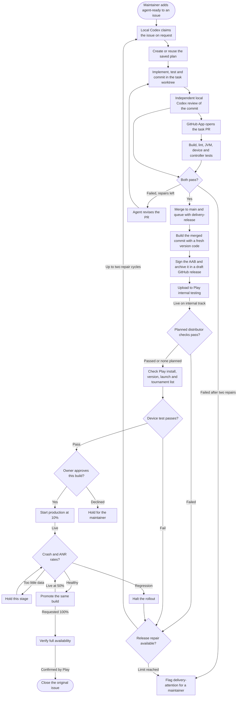

# Chess Tournament Manager

Android app for running chess tournaments: Swiss (FIDE C.04.1 style) and Round Robin pairings, standings, tiebreaks, backup/restore, and optional web publishing.

[Local Temporal viewer](docs/delivery.md#local-temporal-viewer) · [Issue graph on GitHub](https://github.com/Oziomajnr/ChessTournamentManager/blob/delivery-state/STATUS.md) · [Agentic delivery graph](#agentic-delivery-graph) · [Release instructions](#releasing-to-google-play)

## Requirements

- JDK 17
- Android SDK Platform 36
- Android Gradle Plugin 8.13.2 (via the version catalog)
- Gradle 8.13 (via the Gradle wrapper)

## Setup

1. Clone the repo.
2. Copy `local.properties.example` to `local.properties`.
3. Set `sdk.dir` to your Android SDK path.
4. Optional: add Firebase keys for “Publish to web” (see `web/` and `FirebaseConfig.kt`).
5. Optional: configure release signing in `local.properties` (keystore is not in the repo).

## Build

```bash
./gradlew assembleDebug
```

For a local Play release, configure the upload keystore and the production Firebase client settings for “Publish to web” in `local.properties`. Set `PLAY_VERSION_CODE` to an unused integer higher than every version code uploaded in Play Console. Run the following from the repository root.

```bash
./gradlew :app:bundleRelease -PdeliveryVersionCode="${PLAY_VERSION_CODE:?Set an unused Play version code}"
./scripts/verify_play_policy.sh --require-bundle
```

The debug APK is at `app/build/outputs/apk/debug/app-debug.apk`. The Google Play upload is the signed Android App Bundle at `app/build/outputs/bundle/release/app-release.aab`. Play generates the APKs delivered to users from that bundle. [Android App Bundles](https://developer.android.com/guide/app-bundle)

## Tests

```bash
./gradlew testDebugUnitTest
```

The JVM suite covers Swiss pairing rules and review-request frequency. CI also runs lint, builds the app, runs `python3 -m unittest discover -s delivery/tests` for the delivery controller and runs `:app:connectedDebugAndroidTest` on an API 36 emulator.

Release-policy verification:

```bash
./scripts/verify_play_policy.sh
```

This verifies the resolved release dependency graph, merged release manifest, and—when already
built—the release AAB. It fails if the app stops targeting API 36 or if Google Play Billing is
added back to the release.

## Monetization

The app is free and has no subscriptions or in-app purchases. Features are not gated behind a
Pro tier. Do not add Google Play Billing or the `com.android.vending.BILLING` permission without
revisiting the product decision, store declarations, privacy policy, and release-policy checks.

## Web viewer

Static site and Firebase rules live under `web/`. Deploy with the Firebase CLI as needed.

## Agentic delivery graph

A maintainer labels an issue `agent-ready`, then asks local Codex to pick it up. GitHub tracks the issue, runs CI and delivers the reviewed commit to Google Play. The GitHub graph places each issue at its current step. Open its workflow in the local Temporal Web UI to follow recorded stage changes as they arrive. [Local Temporal viewer](docs/delivery.md#local-temporal-viewer) · [Local pickup](docs/delivery.md#local-codex-pickup) · [Delivery policy](delivery/policy.py)



The controller tracks one signed bundle by its merge commit, version code and SHA-256. If Play rejects or halts a release, it follows the same repair path as a failed device test. A replacement goes through internal testing and production approval again. [Tester setup and rollout health thresholds](docs/delivery.md#internal-testing-and-production)

## Releasing to Google Play

### A change delivered through a GitHub issue

1. **Queue and pick up the work.** Apply `agent-ready` to an issue. In the local Codex client, ask “Pick up the next agent-ready issue” or name the issue number. Codex works in a separate checkout and submits its reviewed commit to GitHub. GitHub runs CI, merges under branch protection, and adds `delivery-release` to the issue.
2. **Build and distribute internally.** The release workflow picks up one recorded merge at a time, assigns a fresh version code, and signs the AAB with the protected upload key. Its draft GitHub release contains `candidate.zip` with the AAB and a manifest recording the commit, version code and SHA-256. The workflow uploads that bundle to Play internal testing.
3. **Verify the internal build.** Record each planned distributor check against the published version code and bundle digest. On an enrolled tester device, install or update through Google Play. From a trusted checkout, run `python3 -m delivery.adapters.android_smoke --serial DEVICE_SERIAL --watch` with ADB and an authenticated maintainer GitHub CLI. The worker checks the installer, version, launch and tournament list. [Post-upload evidence](docs/delivery.md#internal-testing-and-production) · [Review-card test procedure](docs/in-app-review-plan.md)
4. **Approve production once.** Open the **Deliver a release** run awaiting review. Check the release notes, device result and bundle digest, then select **Review deployments** and approve `production`. The controller promotes the same version to 10%, then 50%, then 100%. Insufficient crash or ANR data holds the current stage. The issue closes once Play reports full availability. [Release runs](https://github.com/Oziomajnr/ChessTournamentManager/actions/workflows/release.yml) · [Workflow graph and health thresholds](docs/delivery.md)

### An app change already merged outside the task workflow

The release queue requires the task's recorded PR and merge commit. Running `advance` against an empty queue finishes after selection. For a manual release, the maintainer controls the rollout through Play Console.

1. Check **Test and release → Latest releases and bundles** for used version codes. Build the intended commit with a fresh code and the registered upload key. [Local build instructions](#build)
2. Create an **Internal testing** release with the signed `.aab`. Once Play makes it available, install it from the store with an enrolled tester account and check the feature.
3. Promote the tested version to production when ready. Choose the rollout percentage and monitor Android vitals in Play Console as you expand it. [Play staged rollouts](https://support.google.com/googleplay/android-developer/answer/6346149)

### Checking readiness

With GitHub CLI authenticated, run the following check on `main`.

```bash
gh workflow run release.yml --ref main -f mode=verify
```

This checks Play track and vitals access, the production approval configuration, the package and version inside the bundle, and its upload signature. The signed verification copy lasts for the job. A registered automated candidate has a draft GitHub release containing `candidate.zip`. Play Console shows when that version actually becomes available to testers or production users.

## License

See repository license (add one if you publish publicly).
