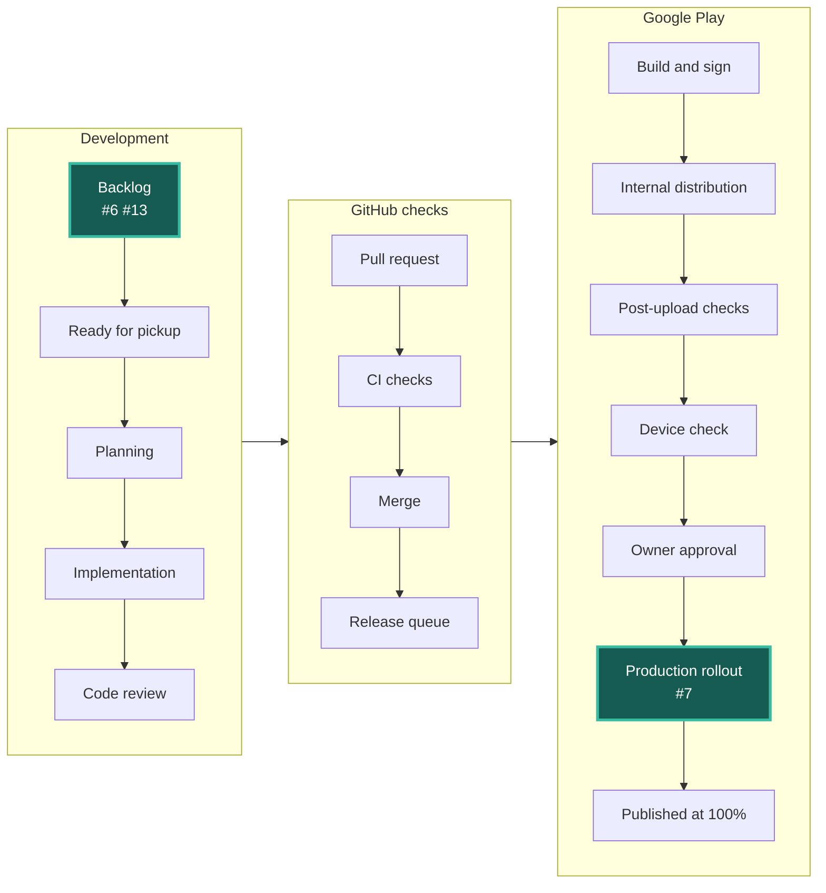

# Issue delivery status

Issue numbers mark their current stage. Follow a single issue's live timeline on your Mac. [Local Temporal viewer](https://github.com/Oziomajnr/ChessTournamentManager/blob/main/docs/delivery.md#local-temporal-viewer)

## Open issues

| Issue | Stage | Next step | Evidence |
| --- | --- | --- | --- |
| [#6 Raise release DEX obfuscation from 0% to at least 25% by February 2027](https://github.com/Oziomajnr/ChessTournamentManager/issues/6) | Backlog | A maintainer can label this issue agent-ready. | — |
| [#7 Update the transitive AndroidX Fragment dependency flagged by Google Play](https://github.com/Oziomajnr/ChessTournamentManager/issues/7) | Production rollout | Waiting for Play to confirm 10%. | [PR #11](https://github.com/Oziomajnr/ChessTournamentManager/pull/11) · [Commit aa6417c](https://github.com/Oziomajnr/ChessTournamentManager/commit/aa6417cbf203aefbf552946f59f74e62709a514f) · [Production approval](https://github.com/Oziomajnr/ChessTournamentManager/actions/runs/45740723162) |
| [#13 Invite organizers to support app development with a one-time donation](https://github.com/Oziomajnr/ChessTournamentManager/issues/13) | Backlog | A maintainer can label this issue agent-ready. | — |
