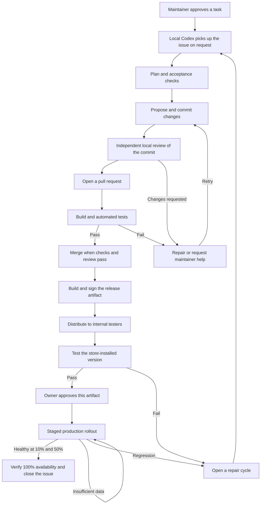

# Task delivery

The delivery policy accepts JSON and returns the next action. It runs with Python 3.9 or later and the standard library. The task host supplies issue state, review results and build checks. The distributor supplies testing availability, production availability, rollout percentage and health measurements. The artifact identity combines the source revision, build identifier and SHA-256 digest. Another project can replace the adapters and use the same policy.



```sh
echo '{"kind":"task","state":{"planned":true,"has_change":true,"checks":"passed","review":"pending"}}' | python3 -m delivery.workflow
python3 -m unittest discover -s delivery/tests
```

## Task intake and merge

Add `agent-ready` to a GitHub issue as a maintainer. From chat or a shell, create the canonical issue with the following command and the approved task description. The issue stays open through release.

```sh
python3 -m delivery.adapters.github "Task title" task.md
```

### Local Codex pickup

In the local client, ask **“Pick up the next agent-ready issue”** or **“Pick up issue #7.”** The label queues the task until a maintainer asks for pickup. The Mac needs an authenticated maintainer GitHub CLI, Git, Python 3.9 or later and a Codex CLI signed in with ChatGPT. Commands run from the trusted main checkout.

```sh
python3 -m delivery.local list
python3 -m delivery.local pickup 7
```

Pickup claims the remote issue and prints its saved task, plan and isolated worktree under `.delivery-worktrees/`. Two clients racing for an issue cannot both acquire its record. Calling pickup with the same number resumes your checkout. To move your own claim to another checkout, use `pickup ISSUE --resume` after preserving any unpushed work.

For a new issue, the local client records a plan before submitting code. Pass JSON on standard input to `python3 -m delivery.local plan ISSUE`. A standings fix could use the following plan.

```json
{"acceptance":["Standings keep their order after reopening a tournament."],"checks":["Run the standings regression test."],"release_notes":"Preserves standings order when reopening a tournament."}
```

Implement, test and commit in the returned worktree. For Android tests, set `ANDROID_HOME` to the SDK path from the main checkout's `sdk.dir` and use JDK 17. Worktrees can build and test using the debug configuration.

From the main checkout, run `python3 -m delivery.local submit ISSUE`. It reviews the exact commit in a separate ChatGPT-authenticated Codex session, pushes the reviewed revision and wakes the main-branch orchestration workflow. Resubmitting the same reviewed commit reuses its verdict. A new commit needs a fresh review. The locally approved dependency constraints are configured per module. Use a pinned declaration such as `constraints { implementation("androidx.fragment:fragment:X.Y.Z") }` inside the existing dependencies block. Other delivery-control or build-script changes go through a maintainer PR.

The GitHub App opens the PR. GitHub runs lint, JVM and emulator tests, build and bundle policy checks. CI completion wakes the controller to reconcile the PR, enforce the same-commit review, and queue the actual merge for release. The worker allows two repair attempts before handing the issue to a maintainer.

The status workflow publishes the GitHub graph and the viewer's data together on `delivery-state`. Issue activity, local handoffs, controller and CI runs, and a pending production approval trigger updates. A half-hourly schedule reconciles outstanding work. Issue numbers appear at their current stage, including repairs, blocked releases and confirmed Play rollouts. The table below the GitHub graph links to the available evidence. [Status on GitHub](https://github.com/Oziomajnr/ChessTournamentManager/blob/delivery-state/STATUS.md) · [Status workflow](../.github/workflows/delivery-status.yml)

The GitHub Pages viewer checks for a new published snapshot every 30 seconds while visible and checks again when you return to the tab. Select an issue to follow it through transitions. The selection is saved in the URL, so you can share a direct link to an issue's graph. [Live viewer](https://oziomajnr.github.io/ChessTournamentManager/)

## Internal testing and production

One candidate advances at a time. The controller reserves a new version code, builds the merged revision, verifies the package and version inside the AAB, and signs it in a separate job. A draft GitHub release stores one archive containing the signed AAB and its manifest. The controller verifies its SHA-256 before internal upload and checks the version and SHA returned by Play. Subsequent stages promote the same version.

Use a dedicated Android device or emulator enrolled in internal testing with Play automatic updates enabled. Run the worker from a trusted checkout with ADB on PATH and an authenticated maintainer GitHub CLI. It waits for Google Play to install the exact candidate, launches the app, opens Tournaments and reports the result against the candidate identity.

```sh
python3 -m delivery.adapters.android_smoke --serial DEVICE_SERIAL --watch
```

The smoke evidence covers install provenance, version, launch and tournament navigation. Account-dependent features such as native Play review-card visibility need separate evidence. The production approval summary links to the PR checks, release notes and device report. An unavailable device holds the release on internal testing.

Approve the pending `production` environment deployment once per artifact. The controller reconciles that approval against the recorded run and artifact before changing the production track. It starts at 10%, advances to 50%, then to 100%. Each partial stage requires complete, fresh daily measurements for that version after the stage became available. The defaults require 100 users for each metric, a period ending within four days, crash rate below 1.09% and ANR rate below 0.47%. Edit the project configuration to change these thresholds. [Android vitals](https://developer.android.com/topic/performance/vitals)

Sparse samples or pending Play review hold the current stage. A measured regression halts a partial rollout and returns the issue for a repair PR. A failed device test also starts a repair. Its replacement receives a new version, digest and approval. Commits to the Play API use `ERROR_IF_IN_REVIEW`. The controller closes the canonical issue after Play reports that exact version published at 100%. [Google Play edit commit](https://developers.google.com/android-publisher/api-ref/rest/v3/edits/commit) · [Release publication states](https://developers.google.com/android-publisher/api-ref/rest/v3/applications.tracks.releases)

## GitHub configuration

| Environment | Values | Purpose |
| --- | --- | --- |
| `delivery-agent` | `OPENAI_API_KEY` | Optional hosted model jobs when explicitly enabled |
| `pr-creation` | `PR_APP_CLIENT_ID` environment variable, `PR_APP_PRIVATE_KEY` environment secret | Opens task PRs from the main-branch job |
| `android-build` | `FIREBASE_PROJECT_ID`, `FIREBASE_API_KEY`, `FIREBASE_WRITE_KEY` | Client configuration for the app’s Publish to web feature |
| `android-signing` | `ANDROID_UPLOAD_KEYSTORE_B64`, `ANDROID_UPLOAD_KEY_ALIAS`, `ANDROID_UPLOAD_STORE_PASSWORD`, `ANDROID_UPLOAD_KEY_PASSWORD` | Android upload signature |
| `play-publishing` | `GOOGLE_PLAY_SERVICE_ACCOUNT_JSON` | Internal distribution, approved production transitions and Android vitals |
| `production` | Required maintainer reviewer, administrator bypass disabled | Records approval for the exact signed artifact |

Restrict each environment to the `main` branch. Install a private GitHub App on this repository only, granting **Pull requests — Read and write** and the implicit metadata read permission. Store its client ID and private key in `pr-creation`. The opener checks the task, label and branch revision with read-only access before minting a short-lived installation token. GitHub's general Actions permission to create and approve PRs stays disabled. The next controller run can recover an existing PR after an interruption.

This repository uses `DELIVERY_AGENT_ENABLED=false` for on-demand local Codex and `DELIVERY_RELEASE_ENABLED=true` for hosted releases. The PR, CI and release jobs operate independently of the hosted model flag. Setting the agent flag to `true` opts unclaimed tasks into the API-backed planner, implementer and reviewer. The optional `DELIVERY_MODEL` variable selects that hosted model. The controller stores task and release records on the `delivery-state` branch using conditional GitHub writes.

The first hosted check verifies a GitHub App token scoped to this repository. The second exercises the production reviewer configuration, Android packaging and signing. Both leave delivery queues and store tracks untouched.

```sh
gh workflow run tasks.yml --ref main -f verify_pr_app=true
gh workflow run release.yml --ref main -f mode=verify
```
